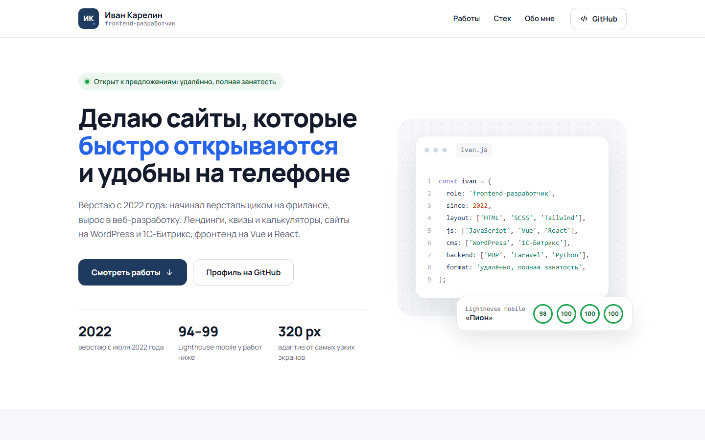
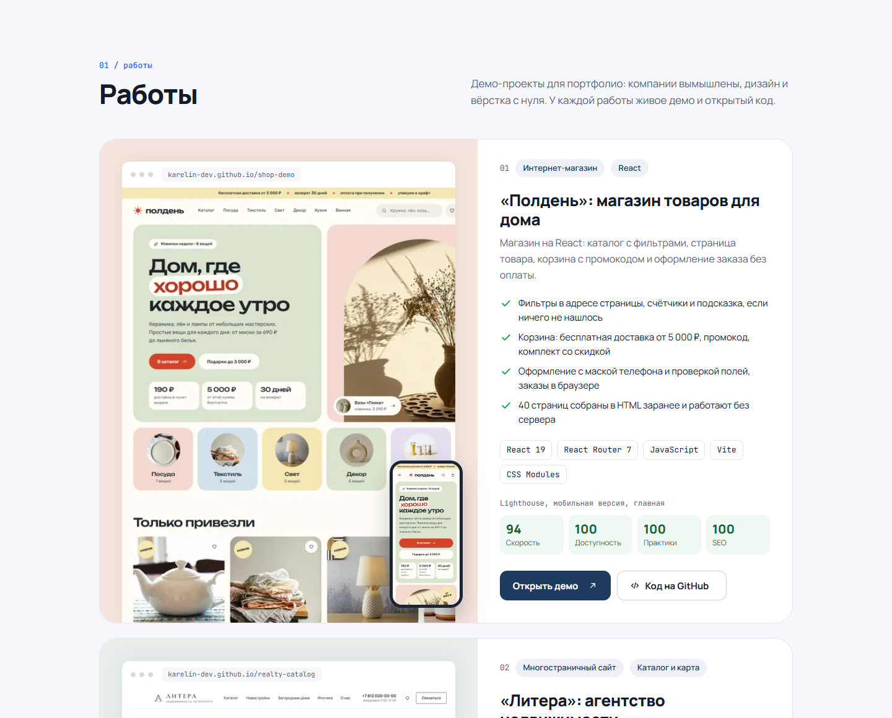
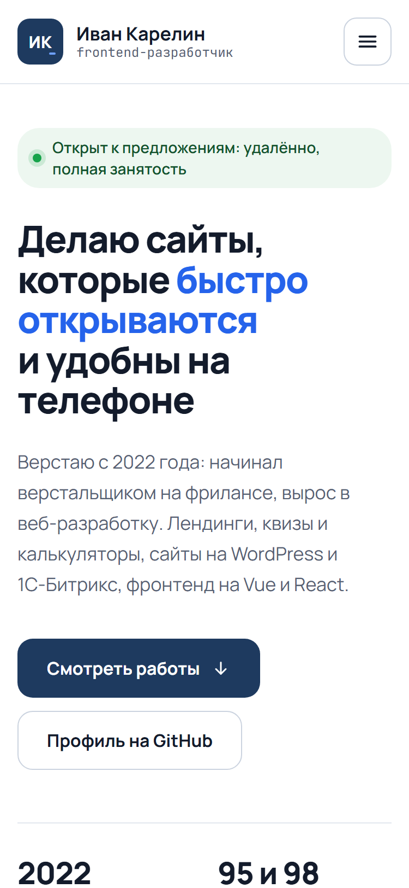

# Витрина портфолио Ивана Карелина

Одностраничный сайт с моими демо-работами: что сделано в каждой, стек, ссылки на демо и код.

**Сайт:** https://karelin-dev.github.io



| Работы | Мобильная версия |
|---|---|
|  |  |

## Что сделано

- **Дизайн с нуля.** Монограмма «ИК», палитра, подбор шрифтов (Manrope и JetBrains Mono),
  макет десктопа. Вёрстка повторяет макет.
- **Карточки работ.** Скриншот десктопа в рамке браузера и мобильная версия поверх,
  что сделано, стек, оценки Lighthouse, ссылки на демо и репозиторий. Ниже работы,
  которые сейчас в процессе.
- **Шрифты со своего домена.** WOFF2 отдельно для кириллицы и латиницы, `preload`
  основного файла, без запросов к Google Fonts. Пока шрифт грузится, текст набран Arial
  с `size-adjust`, подобранным под ширину Manrope: строки переносятся так же, и вёрстка
  не прыгает после загрузки шрифта (CLS 0 вместо 0.12 без этой поправки).
- **Картинки.** Скриншоты в WebP, `srcset` под ширину карточки, ленивая загрузка,
  размеры у всех картинок.
- **JavaScript без библиотек**, ES-модули:
  - мобильное меню: `aria-expanded`, закрытие по Esc, клику мимо меню и переходу
    по пункту, после Esc фокус возвращается на кнопку;
  - подсветка текущего раздела в меню через `IntersectionObserver`;
  - тень у шапки при прокрутке.
- **Доступность.** Ссылка «Перейти к содержимому», видимый фокус, `aria-labelledby`
  у разделов, скрытые подписи у оценок и у кнопок «Открыть демо», номера строк в блоке
  кода через CSS-счётчик (не копируются вместе с кодом), контраст по WCAG AA,
  `prefers-reduced-motion`.
- **SEO и превью ссылки.** `title`, `description`, `canonical`, Open Graph с картинкой
  1200×630, разметка schema.org `Person`.

**Lighthouse на GitHub Pages:** мобильная версия 98 / 100 / 100 / 100,
десктоп 100 / 100 / 100 / 100 (производительность, доступность, Best Practices, SEO).

## Стек

HTML, SCSS (БЭМ, модули `@use`, Dart Sass), JavaScript без библиотек на ES-модулях,
BrowserSync. Шрифты Manrope и JetBrains Mono из пакетов Fontsource, лицензия
SIL Open Font License 1.1.

## Запуск

```bash
npm install
npm run dev     # сервер разработки на http://localhost:3003
npm run build   # шрифты в docs/fonts и сборка CSS в docs/, оттуда сайт публикует GitHub Pages
```

## Структура

```
src/scss/
  _tokens.scss        # цвета, шрифты, размеры, брейкпоинты
  _fonts.scss         # @font-face и резервный шрифт с size-adjust
  _base.scss          # сброс, контейнер, утилиты
  _ui.scss            # кнопки, метки, списки
  blocks/             # header, hero, works, sections
  main.scss
scripts/
  copy-fonts.mjs      # копирует woff2 из node_modules в docs/fonts
docs/                 # сайт для GitHub Pages
  index.html
  css/main.css        # собранный SCSS
  js/
    header.js         # тень шапки и мобильное меню
    nav-spy.js        # текущий раздел в меню
    main.js           # инициализация
  img/                # скриншоты работ в WebP, og.jpg
  fonts/              # woff2
screenshots/          # картинки для README
```

## Автор

Иван Карелин, [github.com/karelin-dev](https://github.com/karelin-dev)
